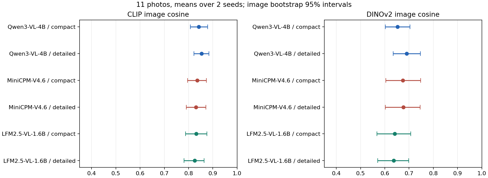
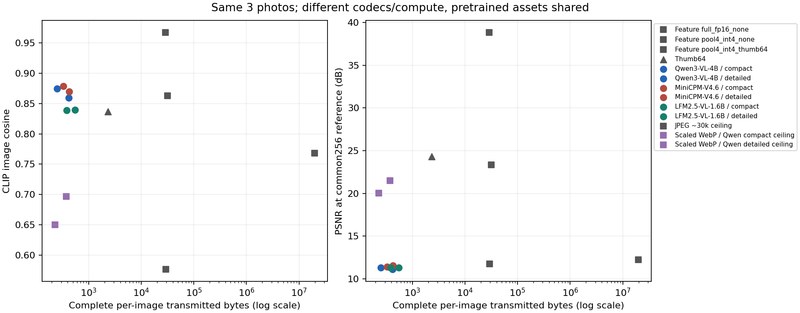
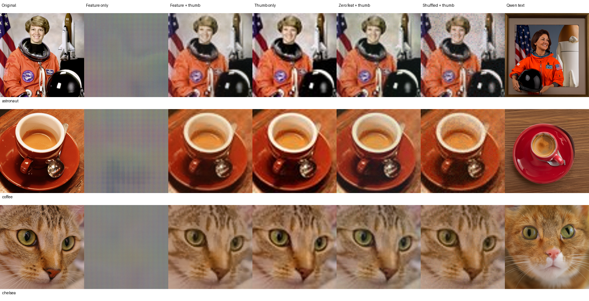
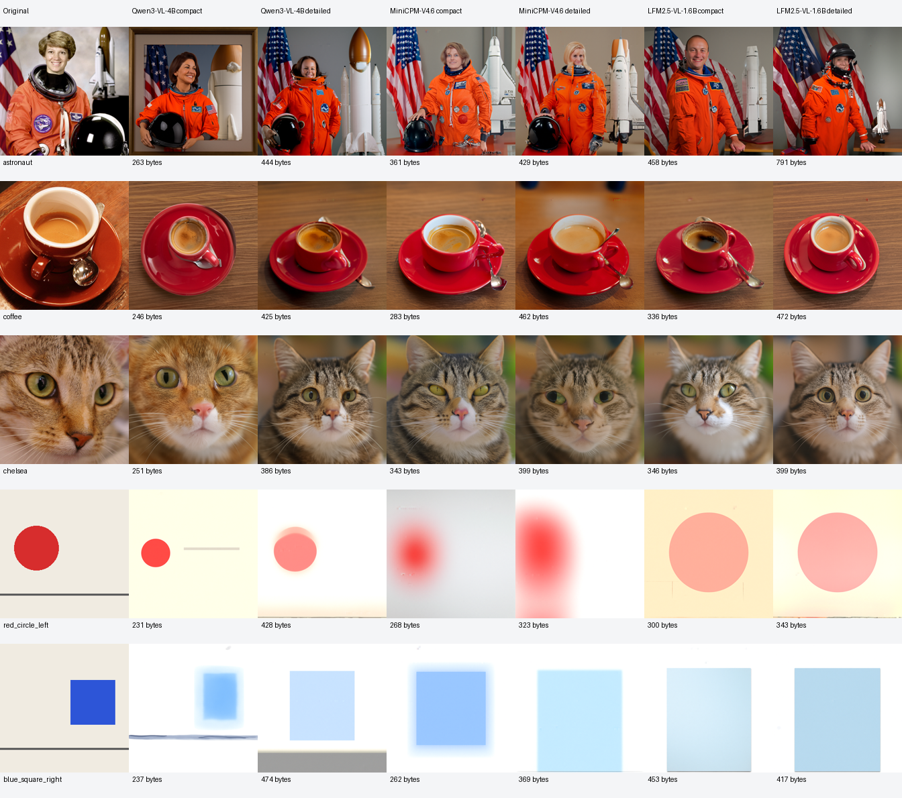
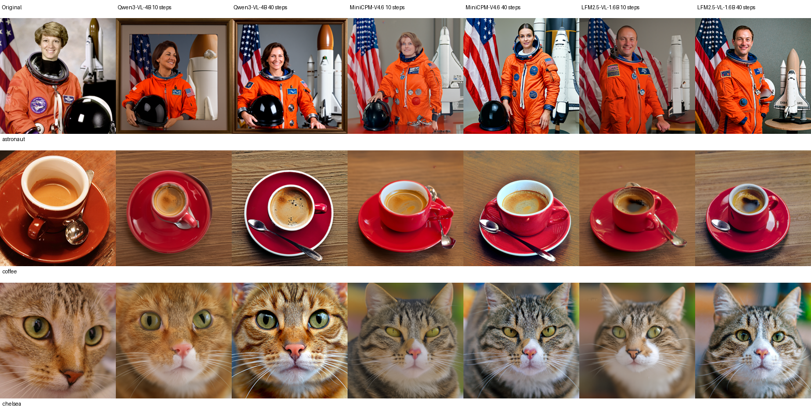

# 画像は「言葉だけ」でどこまで送れるか――中間特徴とプロンプト再生成を比較した小規模検証

2026年10月14日 · lube8163-lab · 探索的なローカル実験

> **AI執筆について**
>
> 本記事は、実験ログと測定結果をもとに、AI（Codex）が構成・執筆しています。実装、モデルの実行、計測も、筆者の依頼に基づいてAIがローカルPC上で実施しました。本文の数値は、保存された検証結果に基づいています。

## はじめに

画像生成モデルの中間表現を送れば、画像を小さなデータに圧縮しつつ、意味を伝えられるのではないかと考えました。そこで、中間特徴を量子化して送る方式と、画像を文章にして受信側で描き直す方式を検証しました。

結論を先にまとめます。今回の写真11枚では、次のような結果になりました。

- 数百バイトの文章でも、「何の画像か」という意味の近さは保てました。
- ただし、元の人物・個体・配置・形状を復元する用途には限界がありました。
- 中間特徴を凍結された出力ヘッドへ渡す今回の方式では、通信効率の優位を確認できませんでした。

特徴から復元する専用の復号器を学習する実験は、まだ行っていません。そのため、中間表現一般の可能性を否定する結果とは考えていません。本記事では、追加学習をしない条件で何ができ、何がまだ不足しているかを整理します。

[全条件の画像・生の説明文を見る](../results/text-route-20261013/report.html) · [コードと測定データ](https://github.com/lube8163-lab/semantic-image-communication-study) · [再現手順](../docs/text-route-reproduction.md)

## 送信したものと、共有済みとしたもの

文章方式の流れは次のとおりです。

```text
入力画像 → VLMによる説明 → UTF-8 JSONパケット
                              ↓
受信側のテキスト符号化 → 共有済みIris-3B → 再生成画像
```

送信したパケットには、文章、乱数種、出力解像度、復号プロトコル名だけを入れました。受信側には元画像、サムネイル、画像を見たVLMの隠れ状態を渡していません。受信側で文章から計算した隠れ状態は受信側のキャッシュであり、画像から抽出して送った情報ではありません。

モデルとトークナイザは、両側で共有済みと仮定しました。したがって「445バイトで画像が再生成できる」という値は、**大きな事前学習済みモデルを用意した後の、画像1枚あたりのペイロード**を指しています。

モデルの初回配布、ネットワークヘッダ、誤り訂正、通信の再送は含めていません。実無線チャネル上の通信実験は行っておらず、別プロセスとファイル受け渡しによって、受信側の入力が分離されていることを確認しました。

## 比較条件

写真11枚と図形2枚を使用しました。写真には、scikit-image の公開例3枚と、公開画像の評価用コホートから事前にハッシュ順で選んだ8枚を含めています。図形は、左右の読み取りと形状の確認用に作りました。

入力はすべて共通の RGB・256×256 の画素とし、中央クロップと Lanczos 縮小を行いました。元データのカテゴリはメタデータのキーワードによる分類であり、厳密な画像分類ラベルではありません。

VLMは、ローカルで実行でき、ネイティブな Transformers 実装があり、モデル条件を固定できる次の3候補を選びました。

| 送信側VLM | 選定上の位置づけ | モデルのライセンス |
|---|---|---|
| [Qwen3-VL-4B-Instruct](https://huggingface.co/Qwen/Qwen3-VL-4B-Instruct) | 品質と制約への追従を確認します。受信側のIrisが使うテキスト符号化器も兼ねます | Apache-2.0 |
| [MiniCPM-V4.6](https://huggingface.co/openbmb/MiniCPM-V-4.6) | 小さな実行資産での比較候補 | Apache-2.0 |
| [LFM2.5-VL-1.6B](https://huggingface.co/LiquidAI/LFM2.5-VL-1.6B) | 小型・短い実行時間の候補 | LFM Open License 1.0 |

MiniCPM の「V4.6」はバージョン名であり、4.6Bパラメータという意味ではありません。モデル本体は公開リポジトリに含めず、固定リビジョンとファイルのSHA-256を記録しました。

各VLMに、英語で40語以内の短文と100語以内の詳細文を依頼しました。生成文は人手で修正せず、語数超過や事実誤認もそのまま残しています。生成には greedy decoding を使い、repetition penalty は1.05に設定しました。入力画素は共通ですが、各モデルのネイティブ前処理は異なります。日本語の説明品質は、今回の比較対象に含めていません。

生成器は [Iris-3B](https://huggingface.co/speridlabs/iris-3b) に固定しました。1024×1024、DPM++ order 2、CFG 3、shift 4、10ステップ、共通の2シードで、13入力×3モデル×2文長×2シード＝156件を生成しました。空文の対照2件と、元の3写真だけの40ステップ追加確認18件も保存しています。

Iris の標準解像度で生成し、評価時には元入力に合わせて256×256へ縮小しました。**公式の100ステップ推奨条件は未検証**です。そのため、Irisの上限性能や、最新モデル全体の優劣を示す比較としては扱っていません。

## 数百バイトでも意味の近さは残る

以下は写真11枚の平均です。各写真内で2シードを平均してから、写真間の平均を求めました。通信量は文章だけの長さではなく、JSON・乱数種・解像度・プロトコル名を含む実パケットのバイト数です。

| VLM | 文長の依頼 | 通信量 B | CLIP画像類似度 | DINO画像類似度 | PSNR dB |
|---|---|---:|---:|---:|---:|
| Qwen3-VL-4B | 短文 ≤40語 | 265 | 0.842 | 0.653 | 10.53 |
| Qwen3-VL-4B | 詳細 ≤100語 | 445 | **0.853** | **0.690** | 10.58 |
| MiniCPM-V4.6 | 短文 ≤40語 | 328 | 0.835 | 0.675 | 10.68 |
| MiniCPM-V4.6 | 詳細 ≤100語 | 418 | 0.831 | 0.676 | 11.03 |
| LFM2.5-VL-1.6B | 短文 ≤40語 | 385 | 0.832 | 0.641 | 10.73 |
| LFM2.5-VL-1.6B | 詳細 ≤100語 | 512 | 0.825 | 0.637 | 10.36 |

CLIPとDINOは、元画像と再生成画像の特徴ベクトル間のコサイン類似度です。正解率を百分率で表したものではありません。PSNRは画素の一致度なので、意味の一致とは分けて読む必要があります。DINO系はIrisのREPA設計にも関係するため、単独で独立な証明とはせず、CLIPと目視例で補いました。



**今回の標準候補には、Qwen3-VL-4B-Instructを選びました。** 詳細文の意味類似度平均が最も高く、短文・詳細文とも13入力すべてで指定した語数を守り、短文の通信量も最小でした。MiniCPMは短文で8/13、LFMは3/13が語数内でした。受信側でQwenが必要になるIrisとの組合せでは、資産を共有しやすい点もあります。

ただし、「Qwenが一般に最良」とまでは結論していません。詳細文のCLIP差について、Qwen−MiniCPMは +0.0225、95%区間 [0.0007, 0.0483]、Qwen−LFMは +0.0283、[0.0036, 0.0645] でした。一方、同じ比較のDINO区間はゼロをまたぎました。短文の順位も確定していません。これらは11写真・10,000回の写真単位ブートストラップによる記述的な区間であり、多重比較補正はしていません。

## 同じ容量なら、縮小WebPとの違いは何か

文章パケットの容量上限に収まるJPEGとWebPも、実際に符号化しました。256×256のままでは小さな上限に収まらない場合があったため、事前に定めた9解像度・8品質の候補から、容量内で最もPSNRが高いものを選ぶ縮小コーデックも比較しました。これは限定されたグリッド探索であり、コーデックの最適なレート歪み曲線を求めたものではありません。

Qwen詳細文の各画像のパケットを容量上限とした結果は、次のとおりです。

| 方法 | 写真数 | 実通信量 B | CLIP | DINO | PSNR dB |
|---|---:|---:|---:|---:|---:|
| Qwen詳細文 → Iris再生成 | 11 | 445 | 0.853 | 0.690 | 10.58 |
| 容量上限内の縮小WebP → 拡大 | 11 | 409 | 0.676 | 0.507 | 21.48 |

文章方式は、共有済みモデルの知識を使って「人物」「鳥」「車」「コーヒー」などの場面を描けます。一方、縮小WebPは、元の色・配置・画素を低い解像度で保持します。**どちらが良いかは、伝えたいものがカテゴリや場面なのか、元画像の具体的な見え方なのかで変わります。**



この図は、特徴方式も測った元の3写真に限定しています。異なるコーデック、精度、計算量を比較しているため、文章方式と特徴方式の容量・計算量を厳密に揃えた優劣検定ではありません。

## 中間特徴を送る方式では、何が分かったか

Iris の最終層トークンを抽出し、そのままFP16で保持するか、空間方向に4×4へ縮約してint4量子化しました。受信側では、既存の凍結出力ヘッドを実行しました。このヘッドは特徴だけでなく画素側の入力も必要なため、画像を渡さない条件では公開乱数、補助画像ありの条件では64px JPEGと公開乱数を使いました。別の特徴専用復号器を学習したわけではありません。

最初の256px検証では75個の中間テンソルを取得し、全要素が有限であることを確認しました。元のnoisy画像を再利用する診断上のヘッド再実行では、出力が完全一致しました。ただし、この元画像へのアクセスは独立受信の証拠には数えていません。最終層の未圧縮FP16特徴は256×2560要素で、約1.31MBと、元の256px RGB8画像の6.67倍になりました。

追加確認では、元の3写真を1024pxへ拡大して特徴を抽出し、受信側を別プロセスで動かしました。条件はσ=0.1、最終層、共通シードです。通信量には実ZIPの全体、量子化スケール、JSON、JPEGを含めています。

| 方式 | 平均通信量 B | CLIP | DINO | PSNR dB |
|---|---:|---:|---:|---:|
| 全トークンFP16、補助画像なし | 19,640,180 | 0.768 | 0.516 | 12.24 |
| pooled int4、補助画像なし | 29,213 | 0.577 | 0.001 | 11.75 |
| pooled int4 ＋64px JPEG | 31,503 | 0.863 | 0.764 | 23.32 |
| 位置をシャッフルした特徴 ＋JPEG | 31,503 | 0.837 | 0.706 | 22.85 |
| ゼロ特徴 ＋JPEG | 31,503 | 0.846 | 0.779 | 22.29 |
| 64px JPEG単体 | 2,329 | 0.837 | 0.829 | 24.34 |



特徴を変えると出力も変わり、一部の類似指標には差が出ました。ただし、特徴＋補助画像は補助画像単体より13.5倍の通信量を使い、PSNRとDINOでは下回りました。CLIPだけを見ると特徴＋補助画像が高くても、それだけで「少ない通信量で元画像をよく伝えた」とは言えません。

**今回の凍結ヘッド方式では、強い文章ベースラインや通常の縮小画像に対する通信効率の優位を示せませんでした。** 学習済みの量子化器・復号器、アダプタ、文章と構造の共同符号化は未検証です。改善の可能性は、これらを試す余地に残っています。

## 文章にすると落ちる情報

平均の特徴類似度が高くても、元画像の事実を保てない例があります。入力と文章を照合した限定的なスポットチェックでは、次の問題が見つかりました。

- Qwenの宇宙飛行士の短文に「framed photograph」が入り、元画像にない額縁が生成されました。
- 右に置いた青い四角を、Qwenの詳細文とMiniCPMは中央と説明しました。Qwenの短文では右と説明できました。
- LFMは左の赤丸を中央と説明しました。ほかに、コーヒーの量や取っ手の方向にも誤りがありました。
- QwenとLFMには、鳥の向きを左右逆に説明する例がありました。逆に、誤った文章でも生成器が元画像と同じ向きに描く例があり、生成事前分布の影響が見られます。
- 顔、猫の個体、車の細部、姿勢は、別のもっともらしい例へ置き換わりました。



これらは、自動指標とは別に保存した観察記録です。独立した人間評価者による盲検評価ではありません。平均スコアを、本人性、個数、向き、精密な形状の保証として扱うことはできません。

## 生成ステップを増やせば解決するか

元の3写真だけ、同じ文章・同じ第一シードで40ステップも生成しました。10ステップとの差は、Qwenの詳細文でCLIP +0.0145、DINO +0.0242、PSNR −0.75dBでした。別のモデル・文長では、類似度が下がる条件もありました。全6条件でPSNRは低下しています。



今回の小さな追加確認では、生成ステップを増やすだけで元画像に一様に近づく結果にはなりませんでした。生成画像の一般的な美しさを評価した結論ではなく、**文章に入っていない情報が、ステップ数を増やすだけで正しく戻るとは限らない**という復元上の問題として捉えています。

## 実装上の失敗と、この検証の限界

最初の256px生成はFP16・FP32とも縞模様になり、512pxでも崩れました。この出力はVLMの能力比較には使わず、診断結果として残しています。標準1024pxで画像生成が成立することを確認した後、全条件を揃えて比較し直しました。

MiniCPMの入れ子テンソルのGPU転送、CLIPの非永続position_idsバッファ、Windowsの一時的な監視JSON読み取りロックにも対処しました。cuDNN attention はマスク付きテキストrefinerで失敗したため、マスクを保持した通常SDPAをrefinerに使い、マスクのないtrunkと画素ヘッドだけでcuDNNを使いました。モデル重みやattention maskを変更して結果を成立させたわけではありません。

実測環境はWindowsです。Tesla V100 32GBでVLMと受信側テキスト符号化を、RTX 5070 12GBでBF16画像生成を実行しました。10ステップ生成は約11.3秒／枚、40ステップは約44.9秒／枚でした。このPC・設定での実測値であり、スマートフォンや通信システム全体の性能を示すものではありません。

対象は既知の公開画像を含む便宜的な11写真で、モデルの学習データとの重複は不明です。専用復号器の学習、実チャネル、100ステップ、複数の生成器、広い未見評価集合、独立人間評価は行っていません。今回の結果から「中間表現は文章より有意に劣る」「これ以上改善しない」という一般論を導くことはできません。

## 次に試すなら

次に試すなら、まずQwenの文章方式を基準として維持し、左右・上下・個数・クロップを明示する説明形式が、どの情報を保てるかを確認したいと考えています。その上で、文章が落とす構造や個体情報だけを、小さな補助表現で送る方式を比較します。大きな中間テンソルをそのまま送るより、同じバイト上限で何を追加できるかを見る必要があります。

専用復号器を学習する場合は、学習用画像と評価用画像を分け、文章のみ・補助表現のみ・両方の対照を置きます。画像単位の対応を保った比較と、人間による個数・配置・形状・本人性の評価も加えたいと考えています。これらは次の研究案であり、本記事の実施済み成果には含めていません。

## データ・コード・出典

公開リポジトリには、コード、固定プロトコル、モデルリビジョンとハッシュ、未修正の78説明文、176生成画像、測定459行、入力13枚、全条件の画像レポートを含めています。モデル本体、依存パッケージ、仮想環境、高次元特徴・テキストキャッシュ、端末の識別子を含む生ログは除外しました。公開用にパスとGPU選択を設定可能にしましたが、別PCでの全推論再実行は未確認です。

- [測定CSV](../results/text-route-20261013/metrics.csv)／[集計と対応比較の区間](../results/text-route-20261013/evaluation-summary.json)
- [入力と元写真の作者・ライセンス](../ASSETS.md)／[固定条件](../docs/text-route-protocol.md)
- [公開物の検証手順](../docs/text-route-reproduction.md)／[コード](https://github.com/lube8163-lab/semantic-image-communication-study)

関連する考え方として、文章を画像表現として用いる [De-Diffusion](https://arxiv.org/abs/2311.00618) と、生成モデルを用いた知覚的画像圧縮の [PerCo](https://arxiv.org/abs/2310.10325) があります。本実験では、これらの再現や性能更新を行っているわけではありません。

図中の元写真とコーデック復元画像には、元画像のライセンスが適用されます。scikit-image の NASA写真はpublic domain、coffeeとchelseaはCC0です。Open Images由来8枚は記録されたCC BY 2.0で、作者・題名・原ページ・クロップ等の変更を[画像出典一覧](../ASSETS.md)に記載しています。参照用の Localized Narratives 文は Pont-Tuset et al., ECCV 2020、CC BY 4.0で、生成入力には使っていません。詳細は、[scikit-image公式データ説明](https://scikit-image.org/docs/stable/api/skimage.data.html)と[Open Images公式のデータ・ライセンス説明](https://storage.googleapis.com/openimages/web/download_v7.html)をご参照ください。

記事本文と独自の測定表・グラフはCC BY 4.0、実験コードはApache-2.0です。AIで再生成した画像は、元の人物や現実の出来事の正確な記録ではありません。
